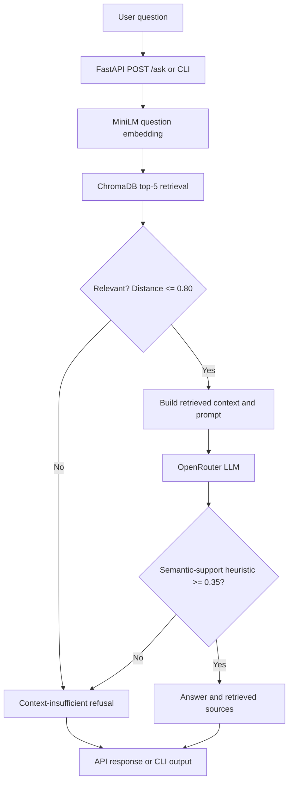

# Parallax AI Internship — Retrieval-Augmented Generation (RAG) System

A Wikipedia-based **retrieval-augmented generation (RAG)** project developed during the **Parallax Labs AI/ML internship (Weeks 1–6)**. The project combines text preprocessing, sentence embeddings, ChromaDB semantic retrieval, context-grounded language-model answers through OpenRouter, NLP enrichment, a FastAPI service, and automated evaluation.

> **Project status:** API unit tests and retrieval/generation evaluation scripts have been run. Reproducibility on a fresh machine depends on providing or recreating the persisted vector collection and verifying the full setup instructions below.

## 1. Project objectives and features

- Prepare and clean a Wikipedia text corpus, then divide it into overlapping text chunks.
- Encode text using `sentence-transformers/all-MiniLM-L6-v2` (384-dimensional embeddings).
- Store embeddings and text in persistent **ChromaDB** for semantic search.
- Retrieve the top **5** chunks for a user question and reject insufficiently relevant retrievals.
- Pass retrieved text to an **OpenRouter** language model with strict context-only instructions.
- Apply an embedding-based answer/context similarity heuristic as an additional hallucination safeguard.
- Enrich selected chunks with **spaCy named entities** and **LDA topics**, enabling topic-filtered retrieval.
- Expose `GET /`, `GET /health`, and `POST /ask` through **FastAPI**.
- Log requests with JSON records and evaluate retrieval, answer proxies, and latency.

## 2. Development timeline

| Week | Work completed |
| --- | --- |
| **1 — Data processing** | Wikipedia ingestion, text cleaning and preprocessing; approximately 5,998 processed documents. |
| **2 — Vector retrieval** | Chunking, MiniLM embeddings, persistent ChromaDB collection, and semantic search. |
| **3 — LLM integration** | OpenRouter integration, prompt engineering, retrieval relevance checks, refusal behavior, and latency measurement. |
| **4 — NLP enrichment** | LDA topic modeling (10 topics), spaCy NER, metadata enrichment, and topic-filtered search. |
| **5 — API and evaluation** | FastAPI service, structured request logging, pytest endpoint tests, Precision@5/pooled Recall@5 evaluation, and generation latency/quality-proxy evaluation. |
| **6 — Documentation and launch** | Source-code documentation, setup instructions, benchmark summary, reproducibility checks, and final project submission. |

## 3. System architecture



**Separate NLP enrichment workflow:** preprocessed chunks → LDA topic labels and spaCy NER → metadata stored in ChromaDB → optional topic-filtered search through `scripts/search_filtered.py`.

**Implementation note:** The standard `/ask` endpoint uses top-5 unfiltered semantic retrieval. Topic filtering is implemented as a separate search script; it is not exposed as an `/ask` API parameter.

## 4. Tools and technologies

| Component | Tool |
| --- | --- |
| Language | Python 3.11 |
| Text embeddings | Sentence Transformers, `all-MiniLM-L6-v2` |
| Vector store | ChromaDB (persistent collection `wikipedia_chunks`) |
| Generation | OpenRouter (OpenAI-compatible client; `openrouter/free`) |
| API | FastAPI, Pydantic, Uvicorn |
| NLP | spaCy (`en_core_web_sm`), scikit-learn LDA |
| Testing and reporting | pytest, JSON evaluation output, Python logging |

## 5. Repository structure

The important files and directories include:

```text
parallax-ai-internship/
├── api/
│   └── main.py                  # FastAPI service, validation, logging
├── evaluation/
│   ├── questions.json          # Evaluation queries and expected keywords
│   ├── relevance_labels.json   # Manually judged relevant candidate IDs
│   ├── retrieval_eval.py       # Precision@5 and pooled Recall@5
│   └── generation_eval.py      # Answer proxies and latency
├── scripts/
│   ├── rag_pipeline.py         # Core retrieval and generation functions
│   ├── search_filtered.py      # Search using NLP topic filters
│   ├── enrich_nlp.py           # NLP metadata enrichment
│   ├── evaluate_ner.py         # Named entity evaluation
│   ├── download_dataset.py
│   ├── process_dataset.py
│   ├── create_chunks.py
│   ├── generate_embeddings.py
│   ├── ingest_chroma.py
│   └── ...                      # Other processing and benchmark helpers
├── tests/
│   └── test_api.py             # FastAPI unit tests
├── data/
│   ├── chroma_db/              # Persistent vector store (local data)
│   └── nlp/                    # Saved NLP outputs
├── results/                    # JSON reports and request logs
├── requirements.txt
├── .env                        # Local secret (do not commit)
└── README.md
```

Some data, models, logs, or generated reports might be excluded from Git. This tree describes known project components and may omit additional local scripts.

## 6. Installation and configuration

Run the commands from the **repository root**.

### Prerequisites

- Python **3.11** and Git
- Internet access for the embedding-model download and OpenRouter API
- An **OpenRouter API key** (free-model access is subject to provider availability and limits)
- Access to the project's ChromaDB collection, or the source data required to rebuild it

### Clone and create a virtual environment

```powershell
git clone https://github.com/sabtiaha-jpg/parallax-ai-internship.git
cd parallax-ai-internship
py -3.11 -m venv .venv
.\.venv\Scripts\Activate.ps1
python -m pip install -r requirements.txt
```

If using macOS or Linux, create the environment with `python3.11 -m venv .venv` and activate it with `source .venv/bin/activate`.

### Configure credentials

Create a `.env` file in the project root:

```dotenv
OPENROUTER_API_KEY=your_openrouter_api_key_here
```

**Never commit `.env` or API keys**. Consider committing a safe `.env.example` with placeholder values instead.

### Set up the persistent knowledge base

The current RAG implementation expects:

- ChromaDB directory: `data/chroma_db`
- Collection name: `wikipedia_chunks`
- Embedding model: `all-MiniLM-L6-v2`
- Local evaluation collection: **20,000 chunks**

The app loads an **existing collection** using `get_collection`; starting the API without it will fail. If `data/chroma_db` is not included in the repository, it must be transferred separately or regenerated from the project's dataset and ingestion scripts.

The repository contains scripts for dataset download, preprocessing, chunk creation, embeddings, and ChromaDB ingestion. **Before claiming a clean-install reproduction**, verify their exact command-line options and processing order, and document any input dataset files needed. Do not rerun ingestion on an existing database without making a backup.

### Start the API

```powershell
python -m uvicorn api.main:app --reload
```

The API should run on `http://127.0.0.1:8000`. Interactive OpenAPI docs are available at `http://127.0.0.1:8000/docs`.

### Run the CLI pipeline

```powershell
python -m scripts.rag_pipeline
```

Enter a question when prompted. Run from the repository root to ensure the local database and imports resolve correctly.

## 7. FastAPI endpoints and examples

| Method | Endpoint | Purpose |
| --- | --- | --- |
| GET | `/` | Returns welcome message and running status |
| GET | `/health` | Returns an API health-status message |
| POST | `/ask` | Retrieves context and generates a grounded answer, or refuses |

**Example request:**

```powershell
curl.exe -X POST "http://127.0.0.1:8000/ask" -H "Content-Type: application/json" -d '{"question":"What is artificial intelligence?"}'
```

PowerShell users can alternatively send a request using `Invoke-RestMethod`:

```powershell
$body = @{ question = "What is artificial intelligence?" } | ConvertTo-Json
Invoke-RestMethod -Uri "http://127.0.0.1:8000/ask" -Method Post -ContentType "application/json" -Body $body
```

**Response shape (illustrative, not a recorded model response):**

```json
{
  "question": "What is artificial intelligence?",
  "answer": "<generated answer, or safe refusal>",
  "sources": ["<retrieved text chunk>"],
  "latency_ms": 6817.0
}
```

The `latency_ms` value above is only an illustration of the response shape; the API measures request-specific latency and will produce a different number.

### Validation, logging, and errors

- The API accepts a `question` string between **1 and 2,000 characters** at the Pydantic model level.
- Blank or whitespace-only questions are rejected with **HTTP 400** after stripping.
- Missing questions or values exceeding the model limits result in **HTTP 422**.
- Unexpected RAG processing errors result in **HTTP 500**.
- JSON request logs are written to `results/api_requests.log` and include timestamp, request ID, HTTP method, path, status code, and duration.
- Responses include an `X-Request-ID` header to help trace requests.

**Note:** `GET /health` confirms the endpoint is accessible; it does not separately test whether ChromaDB or OpenRouter is operational.

## 8. Testing

From the project root with the environment activated:

```powershell
python -m pytest tests/test_api.py -v
```

**Observed run:** 8 of 8 FastAPI endpoint tests passed in **4.80 s** (October 24, 2026). The cases cover home, health, successful request, blank input (400), missing input (422), excessive length (422), out-of-domain refusal, and retrieval error (500).

To run all discovered project tests:

```powershell
python -m pytest -q
```

## 9. Retrieval evaluation

The project first retrieves a **top-20 candidate pool** for each evaluation query. Human judgment selects relevant candidate IDs. The evaluator then performs top-5 retrieval and calculates:

- **Precision@5:** relevant hits among the 5 requested results, divided by 5.
- **Pooled Recall@5:** relevant hits in the top 5, divided by the number of judged relevant documents in that query's **top-20 pool**. This is **not corpus-wide recall**. A query with no judged relevant documents in the pool has undefined pooled recall and is excluded from the recall mean.

```powershell
# Only when labels do not yet exist:
python -m evaluation.retrieval_eval prepare
# Review candidates and manually complete evaluation/relevance_labels.json
python -m evaluation.retrieval_eval evaluate
```

**Observed results (5 questions, k=5):**

| Query | Precision@5 | Pooled Recall@5 | Relevant in pool | Hits |
| --- | ---: | ---: | ---: | ---: |
| What is artificial intelligence? | 0.20 | 0.50 | 2 | 1 |
| What is machine learning? | 0.40 | 0.6667 | 3 | 2 |
| What is the capital of France? | 0.00 | N/A | 0 | 0 |
| What is the Apollo program? | 0.20 | 0.50 | 2 | 1 |
| What is photosynthesis? | 0.00 | N/A | 0 | 0 |
| **Mean** | **0.16** | **0.5556** | — | — |

Results are saved to `results/retrieval_evaluation.json`. The candidate labels were initially selected using previews and should be checked against full chunks before drawing strong conclusions.

## 10. Generation evaluation and benchmarks

Run:

```powershell
python -m evaluation.generation_eval
```

The script reports retrieval time, generation time, total time, whether the output was a refusal, a **keyword-hit-rate proxy**, and a **semantic-support heuristic**. Neither keyword overlap nor embedding similarity is a validated measure of factual accuracy. Manually inspect outputs for correctness.

**Observed example run (October 24, 2026):**

| Query | Best retrieval distance | Best answer-context similarity | Total time |
| --- | ---: | ---: | ---: |
| What is artificial intelligence? | 0.4160 | 0.8995 | 6,817 ms |
| What is machine learning? | 0.6718 | -0.0118 | 3,687 ms |
| What is the capital of France? | 1.0917 | Not evaluated (refusal) | 33 ms |
| What is the Apollo program? | 0.8839 | Not evaluated (refusal) | 30 ms |
| What is photosynthesis? | 0.8567 | Not evaluated (refusal) | 35 ms |

**Mean total time across five queries:** approximately **2,120.4 ms** (computed from the rounded times shown above). This mean combines requests that call the LLM with fast relevance-based refusals; it should not be described as average LLM generation latency. The AI question passed the embedding-based support threshold (`0.35`); the machine-learning question fell below it and was replaced by a refusal. The other three questions exceeded the retrieval-distance threshold (`0.80`) and were refused before generation.

Detailed records are written to `results/generation_evaluation.json`. The reported output doesn't by itself establish final answer correctness, and the five-query sample is too small for production-quality claims.

## 11. NLP enrichment and topic-filtered search

### LDA topic modeling

An **LDA** model identified **10 topics** from the processed text. Example topic keywords:

| Topic | Example keywords |
| --- | --- |
| 0 | film, work, art, book |
| 1 | Apollo, arsenic, water, acid |
| 3 | city, Azerbaijan, oil, Armenia |
| 6 | American, English, player, French |
| 8 | languages, court, Arabic, Greek |
| 9 | war, military, army, British |

Topic labels are provisional keyword-based interpretations and may overlap.

### Named entity recognition

spaCy `en_core_web_sm` extracts named entities; project metadata includes `topic_id`, `topic_name`, `named_entities`, and `entity_texts`. A preliminary **five-chunk** NER evaluation produced **47.06% precision**, **53.33% recall**, and **50.00% F1**. This is too small a sample for dependable generalization.

### Filtered retrieval

```powershell
python scripts/search_filtered.py
```

The script accepts a search query and optional topic ID. Two prior spot checks returned five results with the chosen topic ID: `languages and Arabic` (topic 8, **316.47 ms**) and `military history and wars` (topic 9, **378.39 ms**). These demonstrate topic filtering for those cases, not overall ranking quality.

**Caution:** `scripts/enrich_nlp.py` changes ChromaDB metadata; avoid rerunning enrichment or ingestion casually on an existing database.

## 12. Limitations and next steps

- **Retrieval quality:** Mean Precision@5 was **16%** on a small, five-query evaluation. More representative questions, verified judgments and better retrieval/reranking should be explored.
- **Recall scope:** The reported recall is pooled within top-20 candidates, **not corpus-wide**.
- **Answer validation:** Similarity and keyword heuristics can reject correct paraphrases or accept unsupported claims. A larger, human-reviewed answer evaluation is necessary.
- **LLM provider:** `openrouter/free` may vary in availability, underlying model selection, latency and output behavior.
- **Data portability:** The persistent ChromaDB collection may be too large or unsuitable to store directly in Git. A verified data download or rebuild procedure is needed for a fully reproducible clean setup.
- **NLP annotations:** The NER sample contains only five annotated chunks; LDA topics are not guaranteed to represent coherent human categories.
- **API health:** The health endpoint is a simple service check, not a dependency readiness check.
- **Security:** Production deployment would need appropriate authentication, limits, secret handling, monitoring and operational controls.

## 13. Final submission checklist

- [ ] Verify `requirements.txt` contains the project's actual dependencies and installs in a clean Python 3.11 virtual environment.
- [ ] Confirm `.env` is ignored by Git and no API keys are committed.
- [ ] Confirm the ChromaDB collection is available or clearly provide a verified rebuild process.
- [ ] Run all pytest tests and both evaluation scripts; review the output JSON files.
- [ ] Confirm the API starts and `/docs`, `/health`, and `/ask` behave as expected.
- [ ] Add/update docstrings and type hints in the submitted Python files.
- [ ] Commit and push the final README and relevant source files.
- [ ] Complete the **mandatory Parallax Labs Exit Survey** to unlock the certificate: https://forms.gle/LoMMiesjEywNivjY7

## Acknowledgment

Developed as part of the **Parallax Labs AI/ML Internship**. Repository: https://github.com/sabtiaha-jpg/parallax-ai-internship
